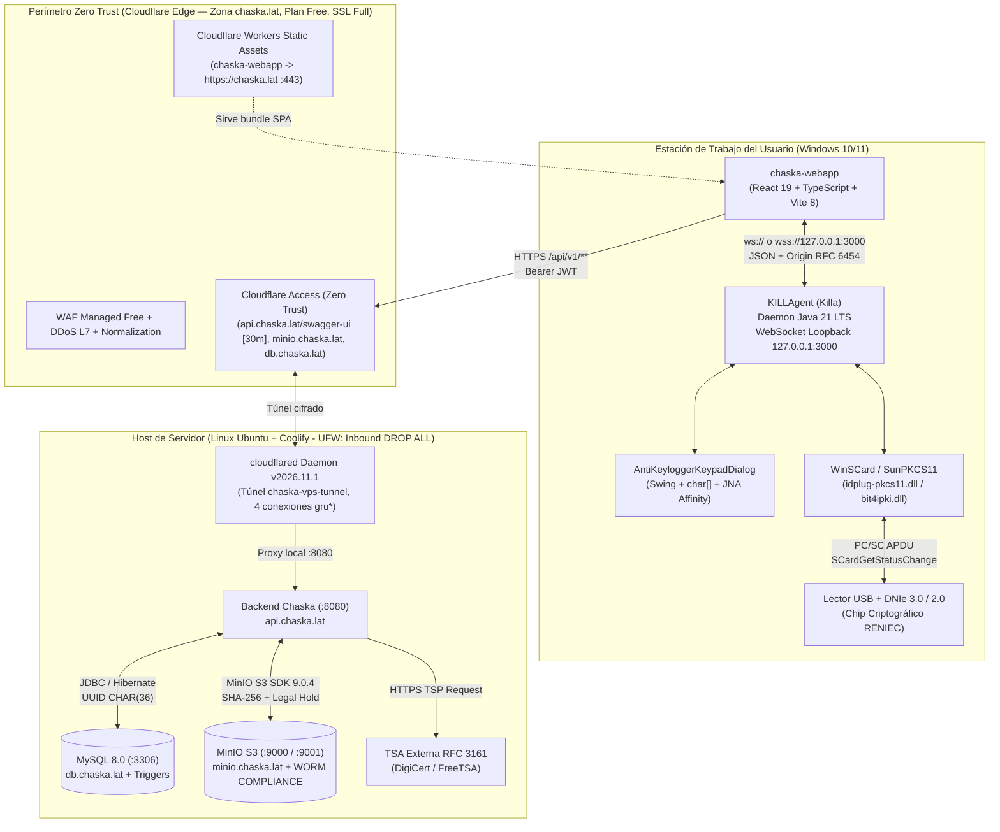
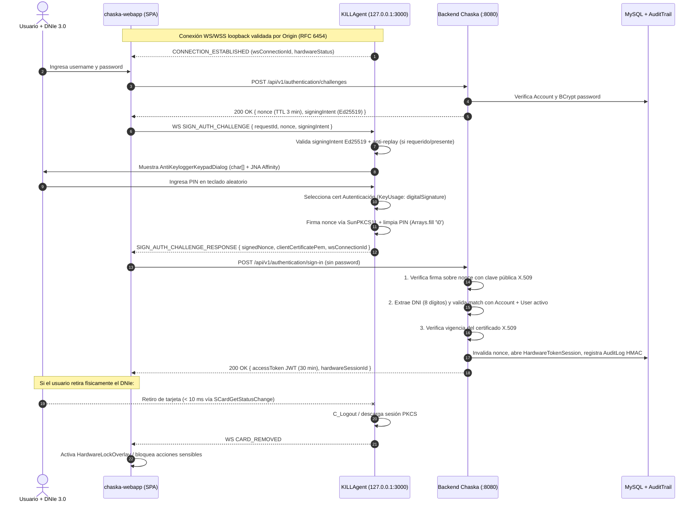

# Contexto Técnico del Sistema Ch'asca para Investigación Académica

**Documento de Referencia Arquitectónica, Criptográfica y Normativa**  
**Plataforma:** Ch'asca (*Zero Trust Document Management & Advanced Digital Signature Platform*)  
**Repositorios Analizados:** `Chaska` (`feat/q1-security-hardening-pades-ltv-audit-arco`), `Killa` / `KILLAgent v1.0.2` (`feat/q1-signing-intent-ed25519`), `chaska-webapp` (`feat/q1-forgery-viewer-traceability-arco-onboarding`)  
**Fecha de Corte del Análisis:** 25 de noviembre de 2026 (post-endurecimiento Q1)

---

## 1. Resumen Ejecutivo y Propósito del Sistema

**Ch'asca** es una plataforma empresarial de gestión documental inmutable, control de acceso basado en confianza cero (*Zero Trust*) y firma digital avanzada diseñada específicamente para Organizaciones No Gubernamentales (ONGs) e instituciones que operan bajo marcos normativos estrictos de preservación archivística, firma electrónica con documento de identidad nacional y protección de datos personales.

### 1.1 Planteamiento del Problema que Resuelve
Las organizaciones del tercer sector (ONGs) y entidades administrativas suelen enfrentar una brecha crítica entre los requisitos de seguridad/cumplimiento y la viabilidad operativa:
1. **Vulnerabilidad en la custodia documental:** Los repositorios tradicionales permiten la alteración silenciosa de archivos o registros históricos por parte de usuarios internos privilegiados o administradores de bases de datos (*rogue DBAs*).
2. **Desacople entre la web moderna y el hardware criptográfico local:** Los navegadores web modernos operan en entornos aislados (*sandbox*) sin acceso directo a lectores de tarjetas inteligentes PC/SC ni a módulos criptográficos PKCS#11 como el **Documento Nacional de Identidad Electrónico peruano (DNIe 3.0 / 2.0)**.
3. **Exposición de credenciales de hardware:** Las soluciones heredadas basadas en applets o formularios web suelen exponer el PIN del ciudadano al DOM del navegador o transmitirlo hacia servidores remotos, incrementando el riesgo frente a *keyloggers*, XSS y captura de pantalla.
4. **Insuficiencia de controles RBAC estáticos:** Los permisos únicamente por rol no contemplan sensibilidad documental, pertenencia departamental, ventanas horarias ni verificación continua de presencia física del token criptográfico.

### 1.2 Objetivos del Sistema
Ch'asca aborda estas problemáticas mediante cuatro pilares de ingeniería:
* **Custodia Documental Inmutable (WORM + Hash SHA-256):** Persistencia híbrida que separa los metadatos administrativos en MySQL 8.0 del contenido binario en almacenamiento de objetos **MinIO S3** con **Object Lock en modo `COMPLIANCE` / `GOVERNANCE`**, versionado estricto y soporte de retención legal (*Legal Hold*).
* **Anclaje Físico de Hardware Air-Gapped (`KILLAgent`):** Daemon nativo de escritorio en Windows que media entre el navegador web (vía WebSocket/WSS exclusivo en `127.0.0.1:3000`) y el chip criptográfico del DNIe vía `WinSCard` y `SunPKCS11`, garantizando que el PIN nunca abandone la memoria volátil (`char[]`) de la estación de trabajo.
* **Arquitectura Zero Trust en Múltiples Capas:** Autenticación multifactor en dos fases (credenciales + prueba criptográfica *challenge-response* con certificado X.509 de autenticación), autorización granular basada en capacidades atómicas (`SystemPermission`) y evaluación contextual ABAC (`ZeroTrustPolicyEvaluator`), junto con detección física de extracción de tarjeta (*Hardware Kill-Switch*) en menos de 10 ms.
* **Trazabilidad Forense Verificable:** Registro de auditoría estrictamente *append-only* (`ImmutableAuditLog`) protegido mediante triggers SQL en base de datos, encadenamiento criptográfico secuencial **HMAC-SHA256** (`JvmAuditQueueWorker` + `recordSynchronous` para eventos críticos) y anclaje externo periódico en MinIO WORM (`audit-anchors/anchor-{logId}.json`) resistente a truncamiento de cola.

### 1.3 Actores y Personas del Sistema (`RoleType`)
El dominio gobierna las capacidades mediante cinco arquetipos macro (`RoleType`), desacoplados de los títulos de puesto institucionales (`BusinessProfile`):

| Persona / Arquetipo | Descripción Funcional | Responsabilidades Principales |
| :--- | :--- | :--- |
| **`ADMINISTRATOR`** | Administración de infraestructura TI y seguridad | Gestión de estructura organizacional, perfiles de negocio, roles y políticas dinámicas ABAC (`AccessPolicy`). |
| **`CREATOR`** | Personal operativo y asistentes | Creación de expedientes, carga de documentos iniciales (`DRAFT`) y nuevas versiones documentales. |
| **`REVIEWER`** | Coordinadores y revisores técnicos | Revisión de expedientes y aprobación técnica intermedia (`IN_REVIEW`), definición/rechazo de espacios de firma. |
| **`SIGNER`** | Directores y representantes legales | Aprobación ejecutiva y firma digital PAdES con certificado de no repudio del DNIe (`PENDING_SIGNATURE` → `SIGNED`). |
| **`AUDITOR`** | Oficiales de cumplimiento y control interno | Inspección de pistas de auditoría (`ImmutableAuditLog`), verificación criptográfica de la cadena HMAC e integridad en MinIO. |

### 1.4 Alineamiento Normativo y Estándares Internacionales

| Norma / Estándar | Ámbito de Aplicación | Implementación Concreta en Ch'asca |
| :--- | :--- | :--- |
| **NIST SP 800-207** | Arquitectura Zero Trust | Autenticación continua, token JWT efímero (30 min), *Segregation of Duties* mediante `SystemPermission`, evaluación contextual ABAC, *Hardware Kill-Switch*. |
| **ISO 15489-1** | Gestión de documentos y preservación | Máquina de estados de ciclo de vida (`DRAFT` → `IN_REVIEW` → `PENDING_SIGNATURE` → `SIGNED` → `ARCHIVED` → `DEEP_ARCHIVED`), custodia WORM y retención documental. |
| **ISO 23081** | Metadatos para la gestión de documentos | Taxonomía jerárquica (`Series` / `DocumentSeries` → `Expedient` → `RecordDocument` → `DocumentVersion`), entidad `DocumentMetadata`, `RecordRelationship` y metadatos S3. |
| **ISO 32000-1 / PAdES-BASELINE-LT** | Firmas electrónicas avanzadas en PDF | Firma incremental sobre diccionario `/Sig` (`/SubFilter /ETSI.CAdES.detached` con `signedAttrs` DER RFC 5035 `signingCertificateV2`, o `/adbe.pkcs7.detached` compatible), cálculo de digest `/ByteRange` SHA-256, contenedor CMS, sello RFC 3161 e incrustación incremental de `/DSS` (`/Certs`, `/OCSPs`, `/CRLs`, `/VRI`). |
| **RFC 3161** | Protocolo de Sellado de Tiempo (TSA) | Estampado criptográfico sobre `SignerInfo.encryptedDigest` con cliente TSA (DigiCert Adobe AATL primario y FreeTSA como respaldo) y sellado opcional de anclas de auditoría. |
| **RFC 8017 (PKCS#1 v1.5)** | Encapsulamiento criptográfico RSA | Empaquetamiento DER `DigestInfo` SHA-256 y firma mediante `NONEwithRSA` (`CKM_RSA_PKCS`) en tarjeta inteligente sin enviar el PDF completo al chip. |
| **RFC 6454 / Ed25519** | Origen web, anti-CSWSH y `signingIntent` | `OriginValidator` en `KILLAgent` con normalización de esquema, host y puerto antes del upgrade WebSocket HTTP 101 + `SigningIntentService`/`SigningIntentVerifier` Ed25519 con anti-replay por `intentId`. |
| **RFC 6960 / RFC 5280** | Revocación PKI en tiempo real | `PkiRevocationValidator` con consulta OCSP + respaldo CRL HTTP con caché por `nextUpdate` y modo `security.pki.revocation.fail-closed`. |
| **Ley N.º 27269 (Perú)** | Ley de Firmas y Certificados Digitales | Diferenciación estricta por `KeyUsage` X.509 tanto en `KILLAgent` como en backend: `digitalSignature` para autenticación y `nonRepudiation`/`contentCommitment` para firma documental. |
| **Ley N.º 29733 (Perú)** | Protección de Datos Personales | Gestión explícita de consentimientos (`DataPrivacyConsent` con `DATA_PROCESSING_NGO` y `ARCO_RIGHTS_ACKNOWLEDGMENT` obligatorios en onboarding) y flujo de derechos ARCO (`ArcoRequest`). |

---

## 2. Arquitectura Global del Ecosistema (3 Subsistemas)

El ecosistema Ch'asca está compuesto por tres repositorios acoplados por contratos explícitos, manteniendo una separación estricta entre la frontera física de hardware del usuario, la interfaz web y el núcleo de servidor.



### 2.1 Invariantes Arquitectónicas del Ecosistema
1. **Aislamiento de Hardware (*Air-Gapped Local Hardware*):** El backend `Chaska` **nunca** establece conexiones directas hacia `KILLAgent` (`127.0.0.1:3000`). El frontend `chaska-webapp` actúa exclusivamente como puente entre los retos/digests emitidos por `/api/v1/**` y las respuestas firmadas generadas por `KILLAgent`.
2. **Aislamiento Total del PIN (*Zero-Network & Zero-String PIN Isolation*):** El PIN del DNIe se captura únicamente en la ventana nativa `AntiKeyloggerKeypadDialog` de `KILLAgent`, almacenado en un `char[]` limpio en sitio (`PinBuffer`), sin entrar jamás al DOM del navegador ni a cargas útiles HTTP.
3. **Kill-Switch Físico de Hardware:** La extracción física del DNIe del lector es detectada nativamente vía `SCardGetStatusChange` en menos de 10 ms, abortando operaciones activas, limpiando sesiones PKCS#11 y emitiendo `CARD_REMOVED` al frontend para bloquear la sesión y mostrar `HardwareLockOverlay`.
4. **Despliegue sin Puertos Entrantes:** En producción, la arquitectura contempla el acceso perimetral a través de Cloudflare Access y túnel saliente `cloudflared`, aislando el backend HTTP `:8080`, MySQL `:3306` y MinIO `:9000` dentro de la red privada del servidor.

### 2.2 Perímetro Cloudflare Zero Trust y `cloudflared` (Verificado vía Cloudflare MCP)
Los datos reales extraídos de la cuenta y zona activa **`chaska.lat`** (Plan *Free Website*) confirman la siguiente topología en producción:
* **Distribución SPA sobre Cloudflare Workers Static Assets (`chaska-webapp` / `wrangler.jsonc`):** A diferencia de Cloudflare Pages (`pages: []`), el frontend `./dist` se despliega como **Worker con Static Assets** (`chaska-webapp`, `has_assets: true`, `compatibility_date: 2026-01-01`, `not_found_handling: single-page-application`) enlazado al dominio raíz `https://chaska.lat` (registro `AAAA 100::` proxied). CORS en `Chaska` habilita `https://*.pages.dev`, `https://*.chasca.ong.pe` y `https://*.chasca.ngo` (además de `https://chaska.lat`).
* **Seguridad de Transporte y WAF/DDoS:** Modo SSL/TLS **`full`**, con cuatro conjuntos de reglas administradas activos en zona: *Cloudflare Normalization Ruleset*, *Cloudflare Managed Response Firewall Default*, *Cloudflare Managed Free Ruleset* (WAF) y *DDoS L7 ruleset*.
* **Túneles Salientes `cloudflared` (`v2026.11.1`, `cfd_tunnel`, 4 conexiones activas en nodos `gru*`):**
  * Túnel `chaska-vps-tunnel` (CNAME proxied): enruta `api.chaska.lat` → `http://chaska-backend:8080`, `minio.chaska.lat` → consola MinIO `:9001`, `db.chaska.lat` → `tcp://*:3306`, con regla *catch-all* `http_status:404`.
  * Túnel de infraestructura (`coolify-*`): enruta `ssh.chaska.lat` para administración remota sin puertos SSH públicos.
* **Cloudflare Access (Zero Trust):** Protege las interfaces administrativas (`api.chaska.lat/swagger-ui` con sesión de `30m` y CORS para `https://chaska.lat`; `minio.chaska.lat` y `db.chaska.lat` con sesión de `24h`) mediante políticas `allow` por identidad/correo verificado.
* **Autenticación Única por `BearerAuth` JWT (`KILLAgent` 2 Fases):** En Cloudflare Access no hay certificados mTLS activos (`access/certificates: []`), y en el backend `ZeroTrustSecurityFilter` opera exclusivamente con **Bearer JWT** emitido tras el protocolo de reto–respuesta de 2 fases con el certificado `digitalSignature` del DNIe en `KILLAgent` (`security.auth.perimeter-mtls-header.enabled=false` por defecto).
* **Resolución Forense de IP (`ForensicRequestContextResolver`):** Extrae la IP real del cliente desde la cabecera `CF-Connecting-IP` únicamente cuando `remoteAddr` corresponde a un proxy confiable (loopback/red interna del túnel `cloudflared`), evitando suplantación de cabecera en auditoría (`ImmutableAuditLog`) y consentimientos ARCO.

---

## 3. Stack Tecnológico Verificado y Métricas del Código Base Actual

Los datos de la siguiente tabla corresponden exactamente a las dependencias declaradas en `pom.xml` (`Chaska`, `Killa`) y `package.json` (`chaska-webapp`), así como al inventario actual de archivos fuente y pruebas:

| Subsistema | Lenguaje / Runtime | Frameworks y Bibliotecas Clave | Almacenamiento / Transporte | Métricas Verificadas del Código |
| :--- | :--- | :--- | :--- | :--- |
| **Backend (`Chaska`)** | Java 21 (LTS) | Spring Boot `4.1.1`, Spring Security, Spring Data JPA, Lombok, Apache PDFBox `3.0.8`, Bouncy Castle `bcpkix-jdk18on` `1.86`, JJWT `0.12.6`, MinIO SDK `9.0.4`, OkHttp `5.5.1`, SpringDoc OpenAPI `2.8.5` | MySQL 8.0 (`CHAR(36)` para UUID), MinIO S3 WORM, H2 en modo MySQL (pruebas), HTTP/REST JSON + Multipart PDF | **491** archivos Java principales<br>**24** archivos de prueba<br>**101** anotaciones `@Test` |
| **Agente Hardware (`Killa` / `KILLAgent v1.0.2`)** | Java 21 (LTS) | `Java-WebSocket 1.5.7`, Jackson `2.17.2`, Bouncy Castle `1.78.1`, JNA `5.14.0`, FlatLaf `3.5.1` + JSVG `1.4.0`, `dotenv-java 3.0.2`, JUnit `5.10.3` | WebSocket / WSS Loopback (`127.0.0.1:3000`), WinSCard (`SCardGetStatusChange`), SunPKCS11, PKCS#12 keystore local | **60** archivos Java principales<br>**16** archivos de prueba/soporte<br>**57** anotaciones `@Test` |
| **Frontend (`chaska-webapp`)** | TypeScript `~6.0.3` / Node | React `19.3.1`, Vite `8.3.6`, React Router DOM `7.18.5`, TanStack React Query `5.106.1`, Axios `1.21.0`, Tailwind CSS `4.3.4`, Lucide React `1.69.0`, React Compiler `1.0.0` | HTTP/REST (`/api` proxy en dev), WebSocket loopback hacia `KILLAgent`, JWT en memoria (`tokenStore`), Cloudflare Pages/Workers (`wrangler.jsonc`) | **59** archivos `.ts` / `.tsx` en `src/` |

---

## 4. Arquitectura Interna del Backend (`Chaska`): Monolito Modular DDD y ACL

El backend está estructurado como un **Monolito Modular** siguiendo **Domain-Driven Design (DDD)**. Cada *Bounded Context* encapsula su modelo de dominio y prohíbe importar directamente repositorios, agregados o servicios internos de otros contextos.

### 4.1 Capas, Patrones y Convenciones Transversales
* **Estructura en 4 capas por contexto:**
  1. `domain`: Agregados (`AuditableAbstractAggregateRoot`), entidades, *Value Objects*, comandos y consultas (Java `record`), interfaces de repositorios y contratos de servicios (`*CommandService`, `*QueryService`).
  2. `application`: Implementaciones `*CommandServiceImpl` (`@Transactional`) y `*QueryServiceImpl` (`@Transactional(readOnly = true)`), además de adaptadores de salida (`outboundservices.acl.*ExternalService` y puertos de infraestructura como `DocumentStoragePort`, `TsaClientPort`).
  3. `infrastructure`: Implementaciones JPA/Hibernate, adaptadores externos (MinIO, PDFBox, RENIEC PKI, TSA), filtros de seguridad (`ZeroTrustSecurityFilter`), trabajadores de cola (`JvmAuditQueueWorker`), aspectería AOP (`AuditedActionAspect`) y seeders idempotentes.
  4. `interfaces`: Controladores REST (`/api/v1/**`) con documentación OpenAPI 3 en inglés, DTOs `record` (`*Resource`), transformadores y fachadas ACL (`interfaces.acl.*.*ContextFacade`).
* **Comunicación inter-contexto (Patrón ACL):** Un contexto consumidor define una interfaz `*ExternalService` en su capa de aplicación que delega hacia la fachada pública `*ContextFacade` del contexto proveedor, evitando el acoplamiento entre modelos de dominio.
* **Jerarquía de Excepciones de Dos Niveles:**
  * `DomainException` (capa de dominio): invariantes puras de negocio y transiciones de estado sin acoplamiento a HTTP (`InvalidEntityStateException`, `DocumentAlreadySignedException`, `AccessPolicyDeniedException`, `PinReauthenticationRequiredException`, `ZeroTrustAuthenticationException`).
  * `ApplicationException` (capa de aplicación): fallos de caso de uso (`ResourceNotFoundException`, `ResourceConflictException`, `ValidationException`, `UnauthorizedApplicationException`, `ForbiddenApplicationException`, `ServiceUnavailableException`).
  * Ambas transportan `timestamp`, `systemMessage` (diagnóstico técnico en inglés, solo para logs internos SLF4J), `userMessage` (mensaje seguro en español para el cliente) y `details`. `GlobalExceptionHandler` (`@RestControllerAdvice`) mapea externamente las excepciones a códigos HTTP (`400`, `401`, `403`, `404`, `409`, `422`, `428`, `503`, `500`) serializando `ErrorResponseResource` sin filtrar jamás `systemMessage` ni trazas de pila.

### 4.2 Descripción Detallada de los 6 Bounded Contexts

#### 1. Contexto `iam` (163 archivos | 8 controladores REST)
Gestiona identidad, autenticación hardware en dos fases, autorización híbrida RBAC/ABAC, sesiones de token físico y privacidad de datos (Ley N.º 29733).
* **Agregados y Entidades:** `Account`, `BusinessProfile`, `Role` (con `RoleType`), `AccessPolicy`, `AuthenticationChallenge`, `HardwareTokenSession`, `AccountOnboardingInvitation` (enlaces temporales de 12 horas), `DataPrivacyConsent` y `ArcoRequest`.
* **Segregación de Capacidades (`SystemPermission` — 14 permisos atómicos):**
  * Identidad y cuentas: `accounts:create`, `accounts:read`.
  * Directorio de usuarios: `users:read`, `users:search`, `users:update`.
  * Estructura organizacional: `organizations:manage`.
  * Gobernanza Zero Trust: `security:read`, `security:manage`.
  * Documentos y firma: `documents:create`, `documents:review`, `documents:sign`.
  * Auditoría forense: `audit:read`, `audit:verify`, `audit:manage`.
* **Evaluación Contextual ABAC (`ZeroTrustPolicyEvaluator`):** Invocable en SpEL (`@zeroTrustEvaluator`) para validar nivel de confidencialidad (`ConfidentialityLevel`), alcance departamental, horario permitido, dirección IP y requisito de re-autenticación por PIN (`428 Precondition Required`). La exención total de políticas contextuales se restringe exclusivamente a quienes poseen `security:manage`.
* **Endpoints principales:**
  * `/api/v1/authentication`: `POST /challenges`, `POST /sign-in`, `POST /reauth-challenges`, `POST /reauth-verify` (emiten `signingIntent` Ed25519 en los retos y validan `KeyUsage: digitalSignature` + `PkiRevocationValidator` OCSP/CRL en `sign-in`, con bypass sandbox deshabilitado por defecto).
  * `/api/v1/accounts`: creación atómica (`POST`), consulta por ID o DNI (`GET`), actualización de perfil/estado (`PATCH`), gestión y completado de invitaciones de onboarding (`/onboarding-invitations`, públicos en `GET /{token}` y `POST /{token}/complete` con consentimiento ARCO obligatorio `acceptedDataPrivacyConsent == true` registrando `DATA_PROCESSING_NGO` + `ARCO_RIGHTS_ACKNOWLEDGMENT`).
  * `/api/v1/business-profiles`, `/api/v1/roles`, `/api/v1/access-policies`: gestión y consulta de gobernanza y `/me/authorization-profile`.
  * `/api/v1/hardware-token-sessions`: apertura (`POST`), heartbeat (`PATCH /{sessionId}`), invalidación (`DELETE /{sessionId}`) y consulta activa (`GET /by-account/{accountId}`).
  * `/api/v1/data-privacy-consents` y `/api/v1/arco-requests`: registro, revocación y ciclo de vida de derechos ARCO.

#### 2. Contexto `users` (64 archivos | 3 controladores REST)
Mantiene el directorio institucional desacoplado de las credenciales IAM (`account_id` $\neq$ `user_id`), la estructura de organizaciones y la jerarquía departamental.
* **Agregados y Entidades:** `User`, `Organization`, `Department` (estructura jerárquica autoreferenciada vía departamento padre).
* **Invariante de Aprovisionamiento Atómico:** La creación de cuenta en `iam` aprovisiona atómicamente su `Account` y su `User` asociado en `users` mediante `UsersContextFacade`. Un colaborador soporta pertenencia a múltiples departamentos.
* **Endpoints principales:**
  * `/api/v1/users`: `/me`, listado, consulta por ID/cuenta/DNI/departamento, actualización de perfil (`PUT /{userId}/profile`), asignación múltiple de departamentos (`POST`/`DELETE /{userId}/departments`) y organización (`PATCH`).
  * `/api/v1/departments`: creación, listado, `/me`, consulta por ID y creación de subdepartamentos (`POST /{departmentId}/sub-departments`).
  * `/api/v1/organizations`: creación y consulta de organizaciones.

#### 3. Contexto `documentmanagement` (103 archivos | 3 controladores REST)
Implementa la taxonomía archivística ISO 15489-1 / ISO 23081, el patrón *Entity-Version* y el almacenamiento físico inmutable en MinIO S3.
* **Agregados y Entidades:** `Series`, `DocumentSeries`, `Expedient`, `RecordDocument` (contenedor lógico), `DocumentVersion` (archivo físico, hash SHA-256, modo y fecha de retención WORM, estado de ciclo de vida), `DocumentMetadata` y `RecordRelationship`.
* **Máquina de Estados (`DocumentLifecycleState`):**
  $$\text{DRAFT} \rightleftharpoons \text{IN\_REVIEW} \rightleftharpoons \text{PENDING\_SIGNATURE} \longrightarrow \text{SIGNED} \longrightarrow \text{ARCHIVED} \longrightarrow \text{DEEP\_ARCHIVED}$$
  *(Nota: `SIGNED`, `ARCHIVED` y `DEEP_ARCHIVED` bloquean reversiones hacia estados editables).*
* **Adaptadores de Infraestructura:**
  * `PdfBoxDocumentInspectorAdapter` (Apache PDFBox 3.0.8): validación de *magic bytes* PDF, inspección de metadatos y conteo de páginas.
  * `MinioS3DocumentStorageAdapter`: persistencia con S3 Object Lock (`COMPLIANCE` o `GOVERNANCE`), bucket versioning, metadatos ISO 23081 (`document-code`, `expedient-code`, `series-code`, `version-number`, `confidentiality`, `sha256-digest`), *Legal Hold* (`enableObjectLegalHold` / `disableObjectLegalHold`) y verificación en vivo de checksum SHA-256 (`statObject` + descarga y recálculo). Cuenta con `InMemoryWormDocumentStorageAdapter` cuando MinIO está deshabilitado en entornos aislados.
* **Endpoints principales:**
  * `/api/v1/document-series` y `/api/v1/expedients`: consulta, creación y cierre de expedientes (`PATCH /{expedientId}/close`).
  * `/api/v1/documents`: `GET /storage/health`, carga multipart (`POST /api/v1/documents` y `POST /{documentId}/versions` con inspección forense anti-A1/A2/A3 en ingesta y evento `PDF_FORGERY_WARNING_DETECTED`), descarga binaria (`GET /{documentId}/versions/{versionId}/content`), verificación de integridad WORM (`POST .../verify-integrity`), trazabilidad documental para usuarios autorizados (`GET /{documentId}/audit-trail?limit=200` protegido por `DocumentAccessGuard` + Step-Up `428`), transición de estado (`PATCH /{documentId}/state`), retención legal (`PATCH .../legal-hold`) y relaciones documentales (`GET`/`POST /{documentId}/relationships`).

#### 4. Contexto `signatureengine` (76 archivos | 1 controlador REST)
Orquesta la detección de espacios de firma, preparación de contenedores PAdES, verificación criptográfica de firmas generadas por hardware, sellado de tiempo RFC 3161 y verificación de validez de certificados y documentos.
* **Agregados y Entidades:** `DigitalSignatureRecord` y `SignatureSlot` (`PENDING`, `SIGNED`, `REJECTED`).
* **Capacidades Principales:**
  * **Detección semántica automática (`PdfAnchorSlotScannerAdapter`):** Escanea el PDF mediante PDFBox buscando etiquetas ancla del formato `[[SIG:ROLE:DNI]]`, calculando sus coordenadas cartesianas `(page, x, y, width, height)` y asociándolas al usuario correspondiente.
  * **Preparación PAdES incremental (`/ByteRange` / `signedAttrs`):** `PdfBoxSignatureStampRendererAdapter` reserva el diccionario `/Sig` y renderiza el sello visual dentro del mismo guardado incremental (preservando firmas previas en multifirma). Si recibe `signerCertificatePem`, usa `/SubFilter /ETSI.CAdES.detached`, construye `signedAttrs` DER (`contentType`, `messageDigest`, `signingCertificateV2` RFC 5035) y devuelve `SHA-256(DER(signedAttrs))` + `signingIntent` Ed25519; si no, mantiene `/adbe.pkcs7.detached`. Tras ensamblar CMS + sello RFC 3161, incrusta incrementalmente el diccionario `/DSS` (`/Certs`, `/OCSPs`, `/CRLs`, `/VRI`) para alcanzar **PAdES-BASELINE-LT**. Carga cadenas emisoras desde un truststore portable configurable (`security.pki.trust-store-path`) con respaldo del SO.
  * **Análisis forense anti-falsificación (`PdfSignatureForensicAnalyzer`):** Inspecciona el binario PDF real en ingesta y en `GET /viewer-summary`, exponiendo `embeddedSignatures` y `visualForgeryWarnings` (`A1_VISUAL_IDENTITY_MISMATCH`, `A2_UNLINKED_VISUAL_STAMP`, `A3_UNSIGNED_VISUAL_FORGERY`, `SHADOW_POST_SIGNATURE_UPDATE`).
  * **Sellado de Tiempo RFC 3161 (`FreeTsaClientAdapter`):** Solicita token TSA sobre el SHA-256 de `SignerInfo.encryptedDigest` (firma RSA cruda) usando DigiCert (`http://timestamp.digicert.com`) con respaldo en FreeTSA (`https://freetsa.org/tsr`) y timeout configurable (5000 ms).
  * **Verificación de Validez (`CertificateValidityServiceImpl` + `PkiRevocationValidator`):** Consulta **OCSP** (RFC 6960) y **CRL** (RFC 5280) con caché por `nextUpdate`, retorno de evidencias crudas para `/DSS` y modo configurable `security.pki.revocation.fail-closed`. Valida además `KeyUsage: nonRepudiation` en firma documental.
* **Endpoints (`/api/v1/document-versions/{versionId}`):**
  * `GET /viewer-summary`, `GET /signature-status`, `GET /eligible-signers`, `GET /integrity-comparison`.
  * `POST /signature-slots`, `POST /signatures/prepare`, `POST /signatures`, `POST /signature-slots/{slotId}/reject`.

#### 5. Contexto `audittrail` (42 archivos | 1 controlador REST)
Proporciona una bitácora forense inmutable con clasificación extensible, procesamiento asíncrono no bloqueante y detección matemática de manipulación.
* **Agregados y Entidades:** `ImmutableAuditLog` y `AuditEventType` (categorías y severidades dinámicas, con bandera `triggersImmediateAlert`).
* **Procesamiento Asíncrono Secuencial y Síncrono Crítico (`JvmAuditQueueWorker`):** Cola en memoria `LinkedBlockingQueue` con capacidad de **50,000 eventos** drenada por un único hilo demonio (`chaska-audit-queue-worker`) bajo `PROPAGATION_REQUIRES_NEW` y sincronización sobre `RowSignatureEngine.AUDIT_CHAIN_LOCK`, más `recordSynchronous` para eventos críticos (`INTEGRITY_TAMPERING_DETECTED`, registro de firma, login exitoso). Cada $N$ eventos (`security.audit.anchor-interval`), publica un ancla inmutable (`AuditAnchorStoragePort` -> `MinioAuditAnchorStorageAdapter` en `audit-anchors/anchor-{logId}.json` con Object Lock `COMPLIANCE` y token RFC 3161 opcional). Valida secreto HMAC fuerte en perfil `prod`.
* **Verificación Anti-Truncamiento (`IntegrityVerificationServiceImpl`):** Lee y verifica primero el último ancla WORM mediante `MessageDigest.isEqual` antes del recorrido secuencial, detectando `TAIL_TRUNCATION_OR_REPLACEMENT` además de `UPDATE`/`DELETE`.
* **Endurecimiento en Base de Datos (`AuditTrailSchemaHardeningRunner`):** Al iniciar sobre MySQL/MariaDB, instala triggers `trg_immutable_audit_logs_no_update` (`BEFORE UPDATE`) y `trg_immutable_audit_logs_no_delete` (`BEFORE DELETE`) que lanzan `SQLSTATE '45000'` ante cualquier intento de modificación o borrado.
* **Captura Declarativa:** Aspecto AOP `@AuditedAction`, escucha de eventos `SecurityAuditEventListener` y fachada `AuditTrailContextFacade`.
* **Endpoints (`/api/v1/audit-logs`):** `GET /`, `GET /{logId}`, `POST /verifications` (auditoría batch completa), `GET /event-types`, `POST /event-types`.

#### 6. Contexto `shared` (22 archivos | 1 controlador REST)
Contiene el kernel compartido: `AuditableAbstractAggregateRoot`, excepciones base, `GlobalExceptionHandler`, `OpenApiConfiguration`, `SnakeCaseWithPluralizedTablePhysicalNamingStrategy` y `HealthController` (`GET /api/v1/health`).

---

## 5. Flujos Criptográficos y Protocolos de Seguridad

### 5.1 Flujo de Autenticación Zero Trust en 2 Fases y Kill-Switch



### 5.2 Flujo de Firma Digital PAdES con Anclaje de Hardware

```mermaid
sequenceDiagram
    autonumber
    actor S as Firmante (SIGNER)
    participant FE as chaska-webapp
    participant BE as Backend Chaska (signatureengine)
    participant MINIO as MinIO WORM
    participant KA as KILLAgent (PKCS#11)
    participant TSA as RFC 3161 TSA (DigiCert/FreeTSA)

    FE->>BE: POST /api/v1/document-versions/{versionId}/signatures/prepare { slotId, signerCertificatePem? }
    BE->>MINIO: Descarga PDF vigente y valida SHA-256
    BE->>BE: Escanea [[SIG:ROLE:DNI]] si no hay slots y asigna SignatureSlot
    BE->>BE: Prepara /Sig incremental (/ETSI.CAdES.detached + signedAttrs si hay cert; /adbe.pkcs7.detached si no) y firma signingIntent Ed25519
    BE-->>FE: { slotId, preparedDocumentHash, originalVersionHash, subFilter, signingIntent }

    FE->>KA: WS SIGN_DOCUMENT_DIGEST { slotId, documentHash, documentTitle, signerRole, signingIntent }
    KA->>KA: Verifica signingIntent Ed25519 + anti-replay + coincidencia de parámetros
    KA->>S: Muestra modal seguro con título y rol verificados del signingIntent + PIN
    S->>KA: Confirma e ingresa PIN
    KA->>KA: Selecciona cert No-Repudio (KeyUsage: nonRepudiation)
    KA->>KA: Encapsula DER DigestInfo (RFC 8017) + firma NONEwithRSA
    KA-->>FE: SIGN_DOCUMENT_DIGEST_RESPONSE { signatureValue, clientCertificatePem, certificateDni }

    FE->>BE: POST /api/v1/document-versions/{versionId}/signatures
    BE->>BE: Verifica match DNI sesión vs certificado, KeyUsage nonRepudiation, OCSP/CRL y firma RSA
    BE->>TSA: Solicita Timestamp RFC 3161 sobre SHA-256(rawSignatureBytes)
    TSA-->>BE: TimeStampToken DER
    BE->>BE: Construye CMS SignedData (signedAttrs + cert + firma + TSA), inyecta en /Contents e incrusta /DSS incremental (PAdES-BASELINE-LT)
    BE->>MINIO: Persiste PDF firmado con Object Lock COMPLIANCE + SHA-256
    BE->>BE: Persiste DigitalSignatureRecord, cierra slot y sella versión si completada
    BE-->>FE: 200 OK DocumentViewerSummaryResource
```

### 5.3 Encadenamiento Criptográfico de Auditoría (`RowSignatureEngine`)
Para impedir alteraciones directas sobre la tabla `immutable_audit_logs` (incluso eludiendo triggers mediante privilegios de superusuario en MySQL), cada registro calcula una firma **HMAC-SHA256** encadenada al registro predecesor. El registro génesis utiliza una semilla de 64 ceros (`0000...0000`).

$$\text{canonicalRecord}_i = \text{timestamp}_i \parallel \text{actorId}_i \parallel \text{ipAddress}_i \parallel \text{eventTypeCode}_i \parallel \text{actionPayload}_i \parallel \text{resourceType}_i \parallel \text{resourceId}_i \parallel \text{fileHash}_i \parallel \text{rowSignature}_{i-1}$$

$$\text{rowSignature}_i = \text{HMAC-SHA256}\left(K_{\text{audit}},\; \text{canonicalRecord}_i\right)$$

Durante la verificación forense (`POST /api/v1/audit-logs/verifications`), `IntegrityVerificationServiceImpl` recorre secuencialmente los registros comprobando simultáneamente que $\text{rowSignature}_i$ coincida con el recálculo y que $\text{previousRowSignature}_i = \text{rowSignature}_{i-1}$. Ante cualquier discrepancia, identifica los IDs corruptos y dispara una alerta de severidad crítica (`INTEGRITY_TAMPERING_DETECTED`).

---

## 6. Arquitectura del Agente Local de Hardware (`KILLAgent` / `Killa`)

`KILLAgent` (v1.0.2) es un servicio local de escritorio en Java 21 LTS diseñado bajo estrictos principios de superficie mínima de ataque y bajo consumo de recursos (< 45 MB de RAM en reposo, arranque < 500 ms).

### 6.1 Controles de Seguridad en Estación de Trabajo
* **Exclusividad Loopback y Bloqueo de Instancia:** Valida mediante `InetAddress.isLoopbackAddress()` que el servidor nunca enlace a `0.0.0.0` ni interfaces LAN, y adquiere un lock de sistema operativo (`SingleInstanceLock` vía `FileChannel.tryLock()` en `%LOCALAPPDATA%\Chaska\KILLAgent\killagent.lock`).
* **Soporte WSS Loopback (`LoopbackSslContextFactory`):** Autoaprovisiona un almacén PKCS#12 para `CN=127.0.0.1` con SAN `IP:127.0.0.1` y `DNS:localhost` para entornos servidos bajo HTTPS (evitando bloqueos por *Mixed Content*).
* **Defensa Anti-CSWSH (`OriginValidator`):** Normaliza esquema, host y puerto contra `ALLOWED_ORIGINS`, bloqueando orígenes `null`, wildcards abiertos en producción y ataques de sufijo/prefijo maliciosos antes de completar el handshake WebSocket.
* **Autenticación de Intención de Firma (`SigningIntentVerifier` Ed25519 + Anti-Replay):** Verifica la firma Ed25519 emitida por el backend (`BACKEND_INTENT_PUBLIC_KEY`, `REQUIRE_SIGNED_INTENT`), valida expiración, impide reutilización de `intentId`, verifica correspondencia con `slotId`/`documentHash` y vincula los datos mostrados en el diálogo WYSIWYS únicamente al `signingIntent` verificado (`ErrorCode.INVALID_SIGNING_INTENT`).
* **Lectura de Certificado sin Doble PIN (`GET_SIGNING_CERTIFICATE`):** Expone en caché en memoria (limpiada automáticamente al extraer la tarjeta) o por lectura pública no autenticada el certificado de no repudio sin abrir jamás `AntiKeyloggerKeypadDialog`.
* **Teclado Anti-Keylogger (`AntiKeyloggerKeypadDialog`):**
  * Arquitectura **Zero-String**: dígitos almacenados únicamente en `char[]` preasignado (`PinBuffer`), limpieza en sitio con `Arrays.fill(pin, '\0')` y `C_Logout` inmediato tras cada firma.
  * Permutación aleatoria de teclas en cada sesión mediante `SecureRandom`.
  * Bloqueo de portapapeles y protección de ventana en Windows 10/11 mediante JNA (`SetWindowDisplayAffinity` con `WDA_EXCLUDEFROMCAPTURE` / `WDA_MONITOR`) contra captura de pantalla y *screen-scraping*.
* **Kill-Switch Nativo (`WinSCardReaderProbe` + `CardReaderManager`):** Escucha bloqueante `SCardGetStatusChange` (0% CPU en reposo, detección < 10 ms) con soporte dual para middleware RENIEC: **DNIe 3.0 IDEMIA** (`idplug-pkcs11.dll`) y **DNIe 2.0 Bit4id** (`bit4ipki.dll`).
* **Distribución y Actualización OTA Segura:** Empaquetado nativo con `jlink` + `jpackage` (`.msi` y `.zip` portátil). El subsistema `update` verifica actualizaciones únicamente por HTTPS contra hosts permitidos (`UPDATE_ALLOWED_HOSTS`), comprobando digest **SHA-256** del binario y firma criptográfica **Ed25519** sobre `update-manifest.json`.
* **Modo Sandbox/Mock para Pruebas:** Configurable mediante `MOCK_HARDWARE_ENABLED=true` en desarrollo, simulando un DNIe 3.0 virtual, conteo de intentos de PIN (`000000` simula error hasta bloqueo) y simulación de retiro físico desde el *System Tray*.

### 6.2 Protocolo de Mensajería WebSocket (`127.0.0.1:3000`)

| Dirección | Tipo de Mensaje | Propósito |
| :--- | :--- | :--- |
| `Agent → Web` | `CONNECTION_ESTABLISHED` | Entrega inicial de `wsConnectionId`, versión del agente y `hardwareStatus` (`readerPresent`, `cardPresent`, `readerName`, `cardType`, `isMock`). |
| `Agent → Web` | `CARD_INSERTED` / `CARD_REMOVED` / `READER_STATUS` | Eventos push proactivos en tiempo real. `CARD_REMOVED` dispara el Kill-Switch en el navegador. |
| `Web ↔ Agent` | `GET_HARDWARE_STATUS` → `HARDWARE_STATUS_RESPONSE` | Consulta explícita bajo demanda del estado de lector y tarjeta. |
| `Web ↔ Agent` | `GET_SIGNING_CERTIFICATE` → `SIGNING_CERTIFICATE_RESPONSE` | Consulta sin PIN del certificado de no repudio en caché de sesión o lectura pública (`certificatePem: null` si no está disponible). |
| `Web ↔ Agent` | `SIGN_AUTH_CHALLENGE` → `SIGN_AUTH_CHALLENGE_RESPONSE` | Firma criptográfica del `nonce` con el certificado de autenticación del DNIe (valida `signingIntent` Ed25519 si está presente/requerido). |
| `Web ↔ Agent` | `SIGN_DOCUMENT_DIGEST` → `SIGN_DOCUMENT_DIGEST_RESPONSE` | Firma PKCS#1 v1.5 (`DigestInfo` + `NONEwithRSA`) sobre digest SHA-256 con el certificado de no repudio y validación de `signingIntent` Ed25519. |
| `Agent → Web` | `ERROR` | Respuesta correlacionada por `requestId` con catálogo tipado: `PIN_INCORRECT`, `PIN_LOCKED`, `CARD_NOT_PRESENT`, `USER_CANCELLED`, `OPERATION_IN_PROGRESS`, `CERTIFICATE_EXPIRED`, `PKCS11_ERROR`, `UNAUTHORIZED_ORIGIN`, `INVALID_SIGNING_INTENT`, `MALFORMED_REQUEST`. |

---

## 7. Arquitectura del Frontend Web (`chaska-webapp`)

La aplicación web está construida como una SPA modular (*feature-based*) en **React 19.3 + TypeScript + Vite 8 + Tailwind CSS v4**, compilada con React Compiler y servible sobre Cloudflare Pages/Workers (`wrangler.jsonc`) o Nginx.

### 7.1 Composición de Proveedores y Seguridad en Navegador
En `src/App.tsx`, la jerarquía global envuelve las rutas en el siguiente orden:
`QueryClientProvider` → `KillAgentProvider` → `AuthProvider` → `BrowserRouter` → `ProtectedRoute` + `AppShell`.

* **Almacenamiento Volátil de Sesión (`tokenStore.ts`):** El token JWT se mantiene **exclusivamente en memoria JavaScript** (nunca en `localStorage` ni `sessionStorage`) para mitigar robo de sesión mediante XSS persistente.
* **Resiliencia de Hardware (`KillAgentProvider` + `HardwareLockOverlay`):** Mantiene conexión persistente con `KILLAgent`, reconexión con *backoff* exponencial y suscripción a `onCardRemoved` para bloquear operativamente la interfaz ante el retiro del DNIe.
* **Interceptores API (`apiClient.ts`):** Inyectan automáticamente el token `Bearer` y traducen errores estructurados del backend (`ErrorResponseResource`), incluyendo respuestas `403` / `428` mediante `AuthorizationPolicyModal` para elevar privilegios con PIN en tiempo real (Step-Up Auth).

### 7.2 Rutas y Módulos Funcionales Implementados
* **Rutas Públicas:** `/login` (Login Zero Trust en 2 fases con tarjetas dedicadas `LoginCredentialsCard` y `LoginDnieCard` + ilustración de estado de hardware) y `/registro/:token` (`OnboardingCompletionPage` para completar registro con enlace temporal de 12 horas y **aceptación obligatoria de consentimiento ARCO / Ley N.º 29733**).
* **Rutas Protegidas:**
  * `/dashboard` (`DashboardPage`): Panel principal operativo y accesos recientes.
  * `/departamentos` y `/departamentos/:departmentId` (`DepartmentViewPage`): Navegación organizacional y series documentales asignadas.
  * `/series/:seriesId` (`DocumentSeriesDetailPage`): Gestión de expedientes dentro de una serie documental.
  * `/expedientes/:expedientId` (`ExpedientDetailPage`): Lista de documentos, carga multipart (`UploadDocumentModal`), visor PDF con marca de agua dinámica (`DocumentViewerModal` + `DocumentWatermarkOverlay`), **banner rojo no descartable anti-*Genuine PDF Forgeries* (A1–A3 / Shadow)**, panel de **Firmas Verificadas en Servidor**, **pop-up de trazabilidad documental (`DocumentTraceabilityModal`)** accesible para cualquier usuario autorizado, verificación de integridad y flujo de firma digital PAdES con `KILLAgent`.
  * `/personal` y `/personal/nuevo` (`PersonnelManagementPage`, `CreateWorkerPage`): Administración de colaboradores e invitaciones de onboarding.

---

## 8. Validación, Calidad y Estrategia de Pruebas

El sistema mantiene cobertura automatizada verificable en los repositorios principales:

1. **Suite Backend (`Chaska` — 24 archivos de prueba, 101 métodos `@Test`):**
   * **Aislamiento Determinista:** Ejecución bajo `@ActiveProfiles("test")` con **H2 en modo MySQL** (`MODE=MySQL`, `preferred_uuid_jdbc_type=CHAR`) y `@DirtiesContext` por método en pruebas de integración.
   * **Simulación PKI Criptográfica:** Uso de Bouncy Castle (`bcpkix-jdk18on`) en pruebas para generar dinámicamente pares de claves RSA de 2048 bits, certificados X.509 con formato DN de RENIEC (`CN=..., SERIALNUMBER=DNI..., O=RENIEC, C=PE`) y firmas reales.
   * **Cobertura por Contexto:**
     * `iam`: Pruebas unitarias de agregados y servicios, evaluación de `JwtTokenProvider` y `ZeroTrustPolicyEvaluator`, integración E2E de login en 2 fases, prevención de ataques *replay* sobre el `nonce`, pruebas de RBAC/ABAC (`401`/`403`) y verificación de seeders.
     * `users`: Integridad de modelo organizacional, departamentos jerárquicos y aprovisionamiento atómico.
     * `documentmanagement`: Máquina de estados documentales, inspección PDF y adaptadores MinIO/in-memory.
     * `signatureengine`: Escaneo de anclas `[[SIG:ROLE:DNI]]`, estampado PDFBox, ejecución de firma digital E2E y verificación documental.
     * `audittrail`: Detección de manipulación sobre `ImmutableAuditLog` y prueba de integración `AuditTrailChainIntegrityIntegrationTest` desde el bloque génesis.
     * `shared`: Mapeo de excepciones en `GlobalExceptionHandlerUnitTest` verificando no exposición de `systemMessage`.
2. **Suite Agente Local (`Killa` — 16 archivos de prueba, 57 métodos `@Test`):**
   * Pruebas unitarias e integración de `PinBuffer` (limpieza en memoria), `RsaDigestInfoHelper` y `CryptoService` (auth + PAdES), `CardReaderManager` y `WinSCardReaderProbe`, invariantes de seguridad (`OriginValidator`, loopback, `SingleInstanceLock`, `SigningIntentVerifier` Ed25519 + anti-replay), serialización e integración del servidor WebSocket (`KillAgentWebSocketIntegrationTest` incluyendo `GET_SIGNING_CERTIFICATE` y ataques de sustitución E6), diálogos Swing (`AntiKeyloggerKeypadDialogUiTest`, `WaitForCardDialogUiTest`) y verificación Ed25519/SemVer del actualizador OTA.
   * Pipelines automatizados en `.github/workflows/ci.yml` y `release.yml`.
3. **Verificación Frontend (`chaska-webapp`):**
   * Verificación estática estricta mediante `tsc -b`, `vite build` y `eslint .` (`typescript-eslint` + `eslint-plugin-react-hooks`).

---

## 9. Estado Actual, Limitaciones Conocidas y Trabajo Futuro (Rigor Académico)

Para garantizar honestidad científica y precisión metodológica en la redacción del artículo, se distinguen explícitamente las capacidades implementadas en el estado actual frente a las limitaciones observadas en el código fuente:

| Dimensión | Estado Actual Implementado | Limitación Observada / Trabajo Futuro |
| :--- | :--- | :--- |
| **Revocación PKI en Tiempo Real** | `PkiRevocationValidator` ejecuta consulta **OCSP** (RFC 6960) + respaldo **CRL** HTTP (RFC 5280) con caché por `nextUpdate`, timeout de 3 s y modo configurable `security.pki.revocation.fail-closed` tanto en Fase 2 de login como en firma documental. | En entornos aislados sin salida a Internet o con `fail-closed=false` degrada a vigencia temporal (`VALID_DATES_CRL_OFFLINE`); el despliegue con TSA/OCSP acreditados INDECOPI/IOFE depende de la infraestructura productiva de la ONG. |
| **Perfil PAdES-BASELINE-LT / LTV** | Con `signerCertificatePem` disponible en `prepare`, el sistema usa `/SubFilter /ETSI.CAdES.detached`, `signedAttrs` DER (RFC 5035 `signingCertificateV2`), sello RFC 3161 e incrustación incremental del diccionario `/DSS` (`/Certs`, `/OCSPs`, `/CRLs`, `/VRI`) para **PAdES-BASELINE-LT** (con compatibilidad `/adbe.pkcs7.detached` cuando no se envía certificado previo). | La adición automática de sellos de documento periódicos (*Document Time-Stamp* `/SubFilter /ETSI.RFC3161`) para **PAdES-BASELINE-LTA** y firmas híbridas poscuánticas (`ML-DSA-65`) queda como trabajo futuro. |
| **Anclaje Forense Anti-Truncamiento** | `JvmAuditQueueWorker` mantiene el registro canónico de 9 campos y génesis `0^256`, añade `recordSynchronous` para eventos críticos y publica anclas cada $N$ eventos (`audit-anchors/anchor-{logId}.json` en MinIO WORM `COMPLIANCE`). `IntegrityVerificationServiceImpl` valida el último ancla detectando `TAIL_TRUNCATION_OR_REPLACEMENT`. | La ventana residual máxima sin anclar entre publicaciones sigue siendo de $N-1$ eventos cuando $N > 1$ (compromiso configurable entre RPO e IOPS). |
| **Escalabilidad Horizontal del Backend** | `JvmAuditQueueWorker` usa una `LinkedBlockingQueue` en JVM y `SignatureSlotCommandServiceImpl` mantiene sesiones preparadas `/ByteRange` (`preparedSignatures`) en `ConcurrentHashMap`. | Diseñado de forma óptima para un despliegue **mononodo** institucional (perfil típico de ONG). Para clústeres multi-réplica se requerirá externalizar `preparedSignatures` en caché distribuida (ej. Redis) y serializar la cola de auditoría sobre un broker o secuencia distribuida. |
| **Cobertura de UI en Frontend Web** | El frontend cubre login 2-fases, bloqueo por hardware, estructura organizacional, expedientes, carga/visor PDF con marca de agua, **banner anti-A1/A2/A3 y firmas verificadas en servidor**, **pop-up de trazabilidad documental (`DocumentTraceabilityModal`)**, **consentimiento ARCO obligatorio en onboarding**, firma PAdES y gestión de personal. | El backend ya expone APIs administrativas completas para **verificación batch global de AuditTrail**, **gestión de solicitudes ARCO existentes** y **gestión avanzada de AccessPolicy/Roles**, cuyas pantallas administrativas dedicadas en `chaska-webapp` están pendientes de desarrollo. |
| **Portabilidad de Sistema Operativo del Agente** | `KILLAgent` (v1.0.2) ofrece aislamiento avanzado anti-keylogger, `SigningIntentVerifier` Ed25519 y detección `WinSCard` nativa optimizada para **Windows 10/11**. | La dependencia de `SetWindowDisplayAffinity` (JNA `user32`) y DLLs PKCS#11 de Windows limita la estación de firma a Windows; el soporte para Linux (`pcscd` + X11/Wayland) y macOS es trabajo futuro. |
| **Evaluación Empírica / Benchmarks** | El sistema cuenta con suites automatizadas verificadas (101 pruebas backend + 57 pruebas en agente + build/lint frontend en verde). | La ejecución del protocolo experimental completo (latencias p50/p95/p99, matriz adversarial, conformidad EU DSS y estudio de usuarios SUS/NASA-TLX) está pendiente como fase empírica del artículo. |

---

## 10. Contribuciones Académicas Sugeridas y Palabras Clave

### 10.1 Aportes Principales Defendibles en el Paper
1. **Patrón de Anclaje Criptográfico Web-to-Hardware Air-Gapped:** Arquitectura reproducible que resuelve la incapacidad de las aplicaciones web modernas para operar con tarjetas inteligentes nacionales (DNIe 3.0/2.0) sin exponer el PIN al navegador ni al servidor, combinando WebSocket loopback validado por origen RFC 6454, memoria *Zero-String* (`char[]`), protección de ventana a nivel kernel y *Kill-Switch* físico en < 10 ms.
2. **Integración Práctica de Zero Trust (NIST SP 800-207) y Gestión Archivística (ISO 15489-1 / ISO 23081):** Aplicación conjunta de autenticación en dos fases con hardware, segregación atómica de capacidades (`SystemPermission`), políticas contextuales ABAC y preservación WORM S3 en modo `COMPLIANCE`.
3. **Modelo de Auditoría Forense No Bloqueante con Doble Protección:** Combinación de triggers *append-only* en base de datos relacional y encadenamiento criptográfico HMAC-SHA256 ejecutado mediante un trabajador asíncrono secuencial en $\mathcal{O}(1)$ por petición HTTP.

### 10.2 Palabras Clave (*Keywords*)
* **Español:** Arquitectura Zero Trust; Gestión Documental Inmutable; Firma Digital PAdES; DNI Electrónico (DNIe); PKCS#11; Almacenamiento WORM; Auditoría Forense HMAC-SHA256; Monolito Modular DDD.
* **Inglés:** *Zero Trust Architecture (NIST SP 800-207); Immutable Document Management; PAdES Digital Signature; Smart Card PKCS#11; Air-Gapped Hardware Anchor; WORM Object Storage; Tamper-Evident Audit Trail; Modular Monolith DDD.*
